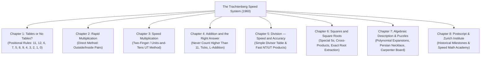

# Trachtenberg Speed Mathematics Studio (2026)

> **The Definitive Interactive Mathematical Calculation System**  
> **Concept & Design by K.S.Chandra 2026**  
> *Based on the authoritative work "The Trachtenberg Speed System of Basic Mathematics" by Ann Cutler & Rudolph McShane (Doubleday & Company, Inc., Garden City, NY, 1960).*

---

## 🌟 Executive Summary & Historical Background

The **Trachtenberg Speed Mathematics Studio** is a comprehensive, colorful, user-friendly, and interactive mathematical calculation software based entirely on the revolutionary system invented by **Professor Jakow Trachtenberg** (1888–1953).

While imprisoned for years in Nazi concentration camps during World War II, Professor Trachtenberg preserved his sanity by visualizing massive numerical problems in total darkness—without paper, pen, or books. In doing so, he developed an entirely new system of mental and written arithmetic that:
1. **Eliminates memorized multiplication tables** beyond basic single-digit additions.
2. **Eliminates multi-row partial product scratchwork**, producing final answers directly onto a single line.
3. **Drastically lowers cognitive strain** by reducing mental carries to small numbers (rarely exceeding 1 or 2).
4. **Introduces the Rule of 11 for Addition**, preventing fatigue by never counting higher than 11.
5. **Guarantees 99%+ accuracy** through intrinsic, built-in dual verification checks (Casting Out 9s and Elevens-Remainder Checks).

Following the war, Professor Trachtenberg established the celebrated **Zurich Mathematical Institute** in Switzerland ("The School for Genius"), where children and adults previously labeled "arithmetically hopeless" rapidly learned to perform complex multi-digit calculations faster than standard calculating machines.

This application translates all **8 Chapters** of Cutler & McShane's 1960 Doubleday book into a modern, visual, interactive software platform with real-time dynamic equation graphs, analytical charts, acoustic sound and speech narration, classic puzzle solvers, and multi-format exports.

---

## 📚 Complete Book Chapters Implemented



### Chapter 1: Tables or No Tables? (Basic Multiplication)
Positional rules eliminate memorized tables:
- **Rule for 11**: Put down the last digit; add each number to its right-hand neighbor; put down the first digit under leading zero.
- **Rule for 12**: Double the number and add its right-hand neighbor.
- **Rule for 6**: Number + "half" the neighbor (drop fractions) + $5$ if the number itself is odd.
- **Rule for 7**: Double the number + "half" the neighbor + $5$ if the number is odd.
- **Rule for 5**: "Half" the neighbor + $5$ if the number is odd.
- **Rule for 9**: First digit: subtract from $10$. Middle digits: subtract from $9$ and add neighbor. Under leading zero: subtract $1$ from neighbor.
- **Rule for 8**: First digit: subtract from $10$ and double. Middle digits: subtract from $9$, double, and add neighbor. Under leading zero: subtract $2$ from neighbor.
- **Rule for 4**: First digit: subtract from $10$ (+ $5$ if odd). Middle: subtract from $9$ + half neighbor (+ $5$ if odd). Under leading zero: half neighbor less $1$.
- **Rule for 3**: First digit: $2 \times (10 - d)$ (+ $5$ if odd). Middle: $2 \times (9 - d)$ + half neighbor (+ $5$ if odd). Under zero: half neighbor less $2$.
- **Rules for 2, 1, 0**: Direct doublings, identity copies, and zero annihilation.

### Chapter 2: Rapid Multiplication by the Direct Method
Multiplies any two numbers of arbitrary length onto a single answer line:
- **Outside & Inside Pairs**: Evaluates pair-products moving symmetrically inward toward the center.
- **Zeroes in Front Rule**: Automatically pads multiplicands with leading zeros equal to the number of digits in the multiplier.
- **Terminal Zeroes Rule**: Automatically collects and appends all trailing zeroes.

### Chapter 3: Speed Multiplication — "Two-Finger" (UT) Method
- **Pair-Product Definition**: Multiplies two adjacent multiplicand digits by a multiplier digit:
  $$\text{PairProduct}(L, R, M) = U(L \times M) + T(R \times M)$$
  where $U$ is the Units digit and $T$ is the Tens digit.
- **Two-Finger Tracking**: Left forefinger tracks Tens ($T$) while right forefinger tracks Units ($U$), preventing mental fatigue.

### Chapter 4: Addition and the Right Answer
- **Golden Rule: "Never count higher than eleven"**: Running totals are reduced by $11$ and marked with a tick $(\prime)$ whenever $11$ is reached.
- **L-Shaped Addition**: Forms the final sum by adding the running column total, column ticks, and the lower-right neighbor in the ticks row.
- **3-Way Verification**: Column nines-remainders, working-table check ($\text{Total} + 2 \times \text{Ticks}$), and elevens-remainder checks.

### Chapter 5: Division — Speed and Accuracy
- **Simple Method**: 10-step repeated addition divisor ladder with running digit-sum verifications.
- **Fast Method**: Employs $NT$ (Number-Tens) and $UT$ (Units-Tens) pair-products with a boundary slash separating quotient digits from the remainder phase.

### Chapter 6: Squares and Square Roots
- **Special Squaring Type 1 (Ends in 5)**: $a \times (a + 1) \mid 25$.
- **Special Squaring Type 2 (Tens is 5)**: $(25 + \text{Units}) \mid \text{Units}^2$.
- **General 2-Digit Squaring**: $[a^2][2ab][b^2]$ with bracket collapsing.
- **3-Digit Squaring**: End square, doubled open cross-product ($2ac$), and front square.
- **Square Roots**: Groups numbers in pairs from the right, extracts root figures, halves remainders (or splits difference if odd: e.g. $5 \to 25$), and verifies using cross-product subtractors.

### Chapter 7: Algebraic Description & Classic Puzzles
- Formal mathematical polynomial proofs:
  $$N = \sum_{n=0}^k a_n 10^n$$
- Proves why $11N = 10N + N$, $6N = \frac{1}{2}(10N) + N$, $9N = 10N - N$, and $8N = 10N - 2N$ generate the exact Trachtenberg rules.
- **The Ancient Persian Necklace Puzzle** (Cutler & McShane p. 247): Solves $x = \frac{1}{3}x + \frac{1}{4}x + 20 \implies 5x = 240 \implies x = 48\text{ pearls}$ with full algebraic breakdown.
- **The Carpenter's Board Puzzle** (p. 227): Solves $x = 3$, $y = 3 + \frac{1}{4}z$, $z = x + y \implies z = 8\text{ ft}, y = 5\text{ ft}$, Total $L = 16\text{ ft}$.

### Chapter 8: Historical Postscript & Speed Math Academy
- Biographical narrative of Prof. Jakow Trachtenberg.
- Founding of the Zurich Mathematical Institute in 1950.
- Cognitive and educational psychology on overcoming arithmetic phobia.
- Interactive Speed Practice Quiz with live stopwatch and streak scoring.

---

## 🎨 Visual & Interactive Capabilities

| Feature | Engine / File | Description |
| :--- | :--- | :--- |
| **📈 Dynamic Equation Graphs** | `equation-graph.js` | HTML5 Canvas engine plotting coordinate curves for all calculation types: linear growth $y = M \cdot x$, summation threshold $S(n)$ at $y = 11$, intermediate division remainder decay, parabola $y = x^2$ with tangent slope $2x$, radical curve $y = \sqrt{x}$, Persian necklace fixed point at $(48, 48)$, and Carpenter board segments. Includes Pan, Zoom (+, -, reset), crosshair tracking, and equation HUD banner. |
| **📊 Analytical Charts** | `charts.js` | Chart.js visualizer featuring Operational Efficiency Comparison (Trachtenberg vs conventional multi-row operations), System Capability Radar Profile, and Step Dynamics & Carry Flow progression. |
| **🔔 Acoustic & Voice Feedback** | `sound-engine.js` | Pure Web Audio API acoustic effects (step pop, 11s tick click, carry chime, victory fanfare) and Web Speech API narration explaining Trachtenberg rules aloud. |
| **🧩 Interactive Puzzles** | `puzzles-and-quiz.js` | Real-time interactive simulators for the Persian Necklace and Carpenter Board with dynamic sliders, tables, and algebra solvers. |
| **⚡ Speed Practice Academy** | `puzzles-and-quiz.js` | Speed math drill game with live millisecond stopwatch, streak tracker, personal record storage, and rule hints. |
| **📥 Multi-Format Downloads** | `export-manager.js` | One-click downloads in 4 formats: Microsoft Word (`.docx`/`.doc`), Print-ready PDF (`.pdf`), Visual Infographic Card (`.png`), and Standalone Interactive HTML (`.html`). |

---

## 🚀 1-Click Launch Options (No PowerShell Required)

The application requires **zero installations, zero Node.js server dependencies, and zero PowerShell execution**:

1. **Desktop Launcher**: Double-click [`Launch_Trachtenberg_Math_Studio.bat`](file:///C:/Users/DuDu-PC/Desktop/Launch_Trachtenberg_Math_Studio.bat) directly on your Windows Desktop.
2. **Folder Batch Launcher**: Double-click [`Open_App.bat`](file:///C:/Users/DuDu-PC/.gemini/antigravity/scratch/trachtenberg-speed-math/Open_App.bat) inside the project folder.
3. **Silent VBScript Launcher**: Double-click [`Launch_Trachtenberg_Studio.vbs`](file:///C:/Users/DuDu-PC/.gemini/antigravity/scratch/trachtenberg-speed-math/Launch_Trachtenberg_Studio.vbs) to launch silently with zero command window flashing.
4. **Direct Browser**: Double-click [`index.html`](file:///C:/Users/DuDu-PC/.gemini/antigravity/scratch/trachtenberg-speed-math/index.html) to open instantly in Google Chrome, Microsoft Edge, Mozilla Firefox, or Brave.

---

## 📁 Project Structure

```text
C:\Users\DuDu-PC\.gemini\antigravity\scratch\trachtenberg-speed-math\
├── index.html                     # Studio user interface and glassmorphic layout
├── style.css                      # Modern neon UI, glassmorphic cards, responsive grid
├── app.js                         # Master controller, chapter routing, event handlers, safe DOM accessors
├── trachtenberg-engine.js         # Pure mathematical calculation engine for all 8 chapters
├── equation-graph.js              # Pure HTML5 Canvas mathematical function and coordinate plotter
├── charts.js                      # Chart.js analytics with visibility guards and safe canvas recycling
├── sound-engine.js                # Web Audio API synthesizer and Web Speech API narrator
├── puzzles-and-quiz.js            # Persian Necklace, Carpenter Board, and Speed Quiz engines
├── export-manager.js              # Word, PDF, Infographic PNG, and Interactive HTML export engine
├── Open_App.bat                   # 1-click batch launcher
├── Launch_Trachtenberg_Studio.vbs # Silent VBScript launcher
├── README.md                      # Comprehensive project documentation
└── HOW_TO_USE.md                  # Detailed step-by-step user guide and tutorial
```

---

## 📜 Source Information & Acknowledgement

* **Source Book**: *The Trachtenberg Speed System of Basic Mathematics* by Ann Cutler & Rudolph McShane (Doubleday & Company, Inc., Garden City, NY, 1960).
* **System Inventor**: Professor Jakow Trachtenberg, Zurich Mathematical Institute, Switzerland.
* **Concept & Design**: **K.S.Chandra 2026**. All rights reserved.
